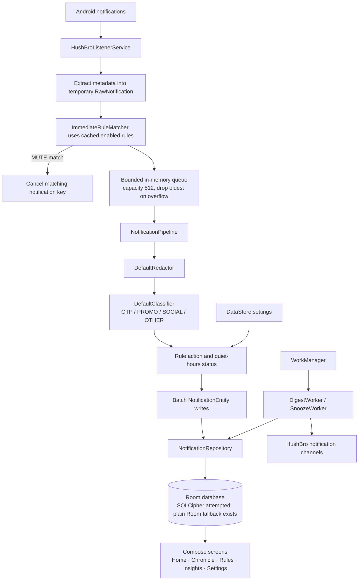

<div align="center">
  <h1>HushBro</h1>
  <p><strong>A quieter way to manage notifications—on your device, on your terms.</strong></p>
  <p>
    
    
    
    
    
  </p>
</div>

HushBro is an offline-first Android notification manager in active development. It captures notifications after you grant Android's Notification Access, applies local processing, and keeps a searchable journal in the app. The goal is to make a busy notification shade easier to manage without sending notification content to a HushBro server.

## Overview

Messages, verification codes, promotions, and social updates all compete for attention. HushBro is designed to help you review that stream on your own schedule: use keyword rules, local categories, a searchable history, scheduled digests, and short snoozes to keep track of what matters.

Notification content is processed on-device. The repository declares no `INTERNET` permission and contains no backend integration. HushBro does require broad Android Notification Access to observe notifications from other apps, so review that access carefully and grant it only if the app's behavior suits you.

## Key features

Status key: **Implemented** means a user-facing path exists in the current source; **Partial** means the feature is present but has important gaps; **Planned / incomplete** means the data model or roadmap exists without working end-to-end behavior.

| Feature | Status | Current implementation |
| --- | --- | --- |
| Offline-first capture and local history | **Implemented** | A `NotificationListenerService` sends notification metadata into an in-process queue and stores processed entries in Room. No network permission or backend is present. |
| Privacy redaction | **Partial** | The default redactor masks common numeric code, card-like number, email, and phone patterns, and clears content marked `VISIBILITY_SECRET`. Pattern matching is heuristic; per-app privacy preferences are not yet applied by the processing pipeline. |
| Custom rules | **Partial** | Rules can be created, edited, enabled, reordered, and deleted. The editor currently offers `MUTE` and `MARK_IMPORTANT`. `ROUTE` exists in the model but is not available in the editor or applied to stored notifications. |
| On-device classification | **Implemented** | A keyword and notification-category heuristic assigns `OTP`, `PROMO`, `SOCIAL`, or `OTHER`. This is not a machine-learning classifier. |
| Searchable notification history | **Partial** | Chronicle provides text search, filters, detail view, removal, and snoozing. The screen uses an unpaged list; app-grouped history and mark-read controls are not wired into the UI. |
| Notification digest | **Implemented** | Daily or weekly WorkManager work can collect held notifications for selected tags and post a HushBro digest. Android may defer scheduled work, and HushBro notifications must be allowed by the system. |
| Notification snoozing | **Implemented** | A history item can be snoozed for a fixed 10 minutes; a WorkManager reminder uses the content already stored by the pipeline. |
| Usage insights | **Implemented** | The Insights screen shows local counts and a seven-day notification chart. |
| CSV export | **Implemented** | Settings exports saved notification rows to a user-selected document. The export can contain message text that passed through the current redaction rules; keep the file private. |
| Per-app privacy controls and retention | **Planned / incomplete** | Supporting data and preferences exist, but settings and processing do not yet enforce the full per-app privacy and retention workflow. |

## Screenshots

No screenshots are checked into the repository yet. Add captures under `docs/screenshots/` when the app UI is ready to share. Suggested views:

| Placeholder | What it should show |
| --- | --- |
| `docs/screenshots/home.png` | Home overview, listener-access state, and recent entries using synthetic notifications. |
| `docs/screenshots/chronicle.png` | Chronicle search, filters, and redacted history entries. |
| `docs/screenshots/rules.png` | Rule list and rule editor, including the actions currently supported. |
| `docs/screenshots/insights.png` | The seven-day chart and local summary metrics. |
| `docs/screenshots/settings.png` | Digest schedule, quiet hours, listener status, and export option. |

Use synthetic notification content in screenshots. Do not capture personal messages, OTPs, or account details.

## Tech stack

| Area | Technology |
| --- | --- |
| Language and Android build | Kotlin 2.0.21, Android Gradle Plugin 8.11.2, Gradle wrapper 8.13, Kotlin DSL |
| Android SDK | Compile / target SDK 36; minimum SDK 26 |
| UI | Jetpack Compose, Material 3, Navigation Compose |
| Local data | Room 2.6.1, Paging 3.3.6, DataStore Preferences 1.1.3 |
| Dependency injection | Hilt 2.51.1 with KSP |
| Background work | AndroidX WorkManager 2.9.1 |
| Database encryption library | SQLCipher for Android 4.14.1 (see [Privacy and security](#privacy-and-security)) |
| Asynchronous processing | Kotlin Coroutines 1.9.0 and Flow |

## Architecture

The app separates Android notification callbacks, processing, persistence, scheduled work, and Compose screens. Hilt provides application-scoped dependencies. Room stores notification history, rules, and app preferences; DataStore holds general settings.



### Main packages

- `service/` connects to Android's notification-listener lifecycle, extracts notification metadata, and keeps a bridge to the active service.
- `pipeline/` contains the bounded queue, redaction, keyword classification, and rule evaluation.
- `data/db/` defines Room entities, DAOs, converters, and the database. `data/repo/` exposes data operations to the rest of the app; `data/prefs/` wraps DataStore settings.
- `di/` provides Hilt bindings, including the default redactor, classifier, and rule engine.
- `notify/` defines HushBro-owned notification channels and digest delivery. `work/` contains digest and snooze workers.
- `ui/` contains Compose navigation and the Home, Chronicle, Rules, Insights, and Settings screens.
- `util/` contains permission helpers, content hashing, and CSV export.

## How it works

1. **Capture:** After Notification Access is enabled, `HushBroListenerService` receives callbacks from Android. It skips HushBro's own notifications and group summaries, then extracts the source package, app label, title, body, timestamp, category, visibility, and notification key.
2. **Apply immediate rules:** The listener checks an in-memory snapshot of enabled rules. A matching `MUTE` rule requests cancellation of that exact notification key; the callback does not cancel all notifications from the source app.
3. **Buffer and process:** A bounded in-memory queue moves work away from the listener callback. The consumer processes batches, applies the default redactor and classifier, assigns a status, and writes through the repository to Room. If the queue fills, its configured overflow policy drops the oldest queued item.
4. **Hold during quiet hours:** When quiet hours are enabled, non-muted notifications are saved with `HELD` status. A configured digest worker can later summarize held items whose tags are selected in Settings.
5. **Review and manage:** Home shows a summary and recent items. Chronicle searches and filters the saved list; its detail dialog can schedule a 10-minute snooze or remove an entry. Insights reads local history for counts and a seven-day chart. Settings manages digest preferences, quiet hours, listener checks, and CSV export.

## Privacy and security

- **Local by design:** The manifest does not declare `INTERNET`, and the source has no backend or network client. Notification processing, classification, rules, and history are local.
- **Notification Access is sensitive:** The listener can observe notifications from other apps. Android requires the user to enable this special access in system Settings; it is not a normal runtime permission prompt. HushBro's banner explains the purpose before opening those settings.
- **Redaction is limited:** The active redactor masks patterns that resemble 4–8 digit codes, card numbers, email addresses, and phone numbers, and removes title/body for `VISIBILITY_SECRET`. These are heuristics and can miss sensitive values or alter ordinary numbers. App-specific private settings are represented in the data layer but are not consulted by the current pipeline. Do not treat redaction as a guarantee that stored or exported text is safe.
- **Database encryption is not production-hardened:** SQLCipher is included and Room attempts to open the database with a hard-coded development passphrase. The code falls back to ordinary, unencrypted Room if SQLCipher initialization fails. There is no Android Keystore-backed passphrase protection in the current implementation. Therefore this repository does **not** guarantee encrypted-at-rest notification history.
- **Backups and system notifications:** The manifest sets `android:allowBackup="false"`. HushBro declares `POST_NOTIFICATIONS`; on Android 13 and newer, the user must allow it for HushBro's own digest and reminder notifications to appear.
- **Exports leave app storage:** CSV export writes to the location selected by the user and may contain redacted notification titles and message text. Protect or delete the exported file as appropriate.

## Installation and setup

### Prerequisites

- Android Studio with Android SDK Platform 36 installed.
- JDK 21 (the project progress notes use Android Studio's bundled JBR 21).
- An Android device or emulator running Android 8.0 / API 26 or newer.

### Build and run

```bash
git clone https://github.com/ChadKevin/HushBro.git
cd HushBro
```

Open the project folder in Android Studio, allow Gradle sync to finish, and select an emulator or connected device. You can also build and install from a terminal:

```powershell
.\gradlew.bat :app:assembleDebug
.\gradlew.bat :app:installDebug
```

The debug APK is generated at `app/build/outputs/apk/debug/app-debug.apk`.

### Required access

1. Launch HushBro and use the Notification Access banner or the Settings screen to open Android's **Notification access** settings. Enable HushBro there, then return to the app.
2. On Android 13 and newer, allow **notifications** for HushBro if you want to receive its digests and snooze reminders. The app also asks for this permission when you use the listener self-test.

HushBro does not need internet access. Gradle may require a network connection to download the Android Gradle Plugin, libraries, and SDK components during setup.

## Project structure

```text
.
├── app/
│   ├── schemas/                         # Exported Room schema
│   └── src/
│       ├── main/
│       │   ├── AndroidManifest.xml
│       │   └── java/com/invictus/hushbro/
│       │       ├── HushBroApp.kt, MainActivity.kt
│       │       ├── data/                # db, prefs, repositories
│       │       ├── di/                  # Hilt modules
│       │       ├── notify/              # App notification channels and digest
│       │       ├── pipeline/            # Capture processing, redactor, rules, classifier
│       │       ├── service/             # Notification listener and bridge
│       │       ├── ui/                  # Components and Compose screens
│       │       ├── util/                # Permissions, CSV, content hash
│       │       └── work/                # Digest and snooze workers
│       ├── test/                        # Unit tests
│       └── androidTest/                 # Instrumented tests
├── gradle/
│   ├── libs.versions.toml               # Version catalog
│   └── wrapper/                         # Gradle 8.13 wrapper
├── AGENTS.md                            # Repository development instructions
├── BUILD_GUIDE.md                       # Requirements and staged build guide
├── HushBro_Build_Guide.pdf              # Detailed implementation guide
├── PROGRESS.md                          # Development log
├── build.gradle.kts
└── settings.gradle.kts
```

## Current development status

HushBro is **in progress**. The checked-in source includes the notification listener, buffered processing, Room repositories, Hilt and DataStore setup, Compose navigation and screens, basic rule editing, local classification, digest and snooze workers, insights, and CSV export.

`PROGRESS.md` needs reconciliation: its opening section says Step 4 is complete and Step 5 is next, while later entries mark Step 5 complete, describe additional UI work, and name Step 6 as the next action. The current source also contains an initial redactor and SQLCipher integration, but these do not complete the broader privacy and security requirements. Treat the log as a development record rather than a precise summary of the current feature set.

Work still needed includes completing redaction and per-app privacy behavior, implementing `ROUTE` as an internal HushBro category, enforcing retention settings, protecting a database key with Android Keystore, removing the unencrypted fallback, improving history behavior, and completing end-to-end verification. See [`BUILD_GUIDE.md`](BUILD_GUIDE.md) and [`PROGRESS.md`](PROGRESS.md) for the project's requirements and recorded roadmap. No build or test result is asserted here.

## Limitations

- Android Notification Access must be enabled by the user, and OEM Android versions may differ in how they keep listener services connected.
- Android controls notification-listener lifecycle and WorkManager timing. A daily or weekly digest can be delivered later than its nominal schedule.
- HushBro can request cancellation of the exact notification it observes when a `MUTE` rule matches. It cannot move another app's notification between that app's Android notification channels.
- **`ROUTE` is intended to assign an internal HushBro label or bucket.** It does not move notifications between other applications' Android notification channels, and the current app does not yet complete this internal routing behavior.
- The queue is in memory and uses a drop-oldest overflow policy; events can be lost during sustained bursts or process termination before a batch is stored.
- Rules and classification use simple keyword matching. They are not semantic or machine-learning systems.
- Redaction and database encryption are incomplete as described above; avoid relying on HushBro as a secure vault.

## Contributing

Contributions are welcome. Before substantial work, check the roadmap and open a GitHub issue to discuss scope. Keep changes focused and do not commit personal notification data, database files, generated build output, signing credentials, or keys.

A typical contribution workflow:

1. Fork the repository and create a branch for one change.
2. Keep the change aligned with `AGENTS.md` and the staged requirements in `BUILD_GUIDE.md`.
3. Use synthetic notification content in tests and demos; never use real personal notifications.
4. Run the relevant checks, for example `./gradlew testDebugUnitTest` and `./gradlew :app:assembleDebug` (or `.\gradlew.bat` equivalents on Windows), and report what you ran.
5. Open a pull request describing the change, verification performed, and any known limitations.

## License

No license file or license declaration is present in the repository. The project has not specified a license; do not assume that reuse, modification, or redistribution is permitted.

## Acknowledgements and contact

HushBro is being developed for **INVICTUS Droidrush 2026**. It is built with the Android and Kotlin ecosystem, including Jetpack Compose, Material 3, Room, Hilt, DataStore, and WorkManager.

For project questions or contributions, use the [GitHub repository](https://github.com/ChadKevin/HushBro), its [Issues](https://github.com/ChadKevin/HushBro/issues), or its [Pull Requests](https://github.com/ChadKevin/HushBro/pulls). No separate contact address is listed.
